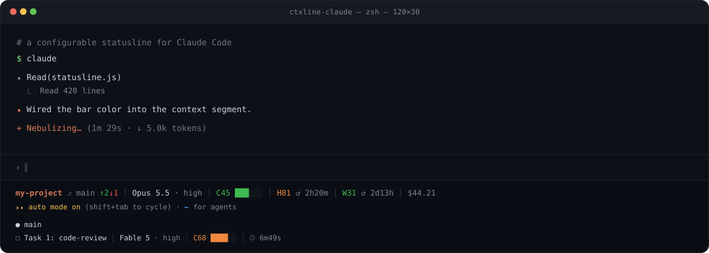
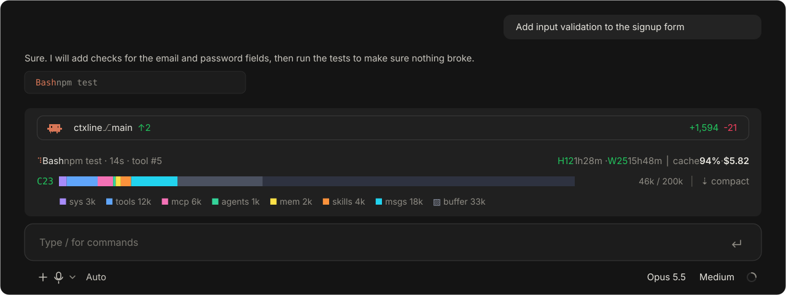

<p align="center">
  
</p>

<h1 align="center">Claude Code Statusline</h1>

<p align="center">
  A lightweight, zero-config statusline for Claude Code.
</p>

<p align="center">
  <a href="https://github.com/MithunWijayasiri/ctxline-claude/stargazers"><picture><source media="(prefers-color-scheme: dark)" srcset="https://www.shieldcn.dev/github/stars/MithunWijayasiri/ctxline-claude.svg?variant=secondary&amp;size=sm&amp;mode=dark"></picture></a>
  <a href="https://github.com/MithunWijayasiri/ctxline-claude/graphs/contributors"><picture><source media="(prefers-color-scheme: dark)" srcset="https://www.shieldcn.dev/github/contributors/MithunWijayasiri/ctxline-claude.svg?variant=secondary&amp;size=sm&amp;mode=dark"></picture></a>
  <a href="https://github.com/MithunWijayasiri/ctxline-claude/commits/main"><picture><source media="(prefers-color-scheme: dark)" srcset="https://www.shieldcn.dev/github/last-commit/MithunWijayasiri/ctxline-claude.svg?variant=secondary&amp;size=sm&amp;mode=dark"></picture></a>
  <a href="https://ko-fi.com/mithunwijayasiri"><picture><source media="(prefers-color-scheme: dark)" srcset="https://www.shieldcn.dev/badge/Ko--fi-support-FF5E5B.svg?logo=kofi&amp;variant=secondary&amp;size=sm&amp;mode=dark"></picture></a>
  <br>
  <a href="https://www.npmjs.com/package/ctxline-claude"><picture><source media="(prefers-color-scheme: dark)" srcset="https://www.shieldcn.dev/npm/ctxline-claude.svg?variant=secondary&amp;size=xs&amp;mode=dark"></picture></a>
  <a href="https://www.npmjs.com/package/ctxline-claude"><picture><source media="(prefers-color-scheme: dark)" srcset="https://www.shieldcn.dev/npm/dm/ctxline-claude.svg?variant=secondary&amp;size=xs&amp;mode=dark"></picture></a>
  <a href="https://www.npmjs.com/package/ctxline-claude"><picture><source media="(prefers-color-scheme: dark)" srcset="https://www.shieldcn.dev/npm/dt/ctxline-claude.svg?variant=secondary&amp;size=xs&amp;mode=dark"></picture></a>
</p>

<p align="center">
  
</p>

Shows your directory, git branch, model, context window, 5-hour and weekly usage limits, session cost, and token counts in one line under the Claude Code prompt.

## Contents

- [Install](#install)
- [What it shows](#what-it-shows)
- [Configuration](#configuration)
- [Update](#update)
- [Uninstall](#uninstall)
- [Claude desktop app](#claude-desktop-app)
- [FAQ](#faq)

## Install

```bash
npx ctxline-claude     # or: bunx ctxline-claude
```

Restart Claude Code or start a new session.

<details>
<summary>Other install methods</summary>

Clone and run the installer:

```bash
git clone https://github.com/MithunWijayasiri/ctxline-claude.git
cd ctxline-claude
./install.sh      # macOS / Linux
./install.ps1     # Windows (PowerShell)
```

Or install by hand. Download the script:

```bash
mkdir -p ~/.claude/hooks
curl -o ~/.claude/hooks/statusline.js https://raw.githubusercontent.com/MithunWijayasiri/ctxline-claude/main/statusline.js
chmod +x ~/.claude/hooks/statusline.js
```

Then add both entries to `~/.claude/settings.json`. The second one draws a row per running subagent in the agent panel.

```json
{
  "statusLine": {
    "type": "command",
    "command": "node ~/.claude/hooks/statusline.js"
  },
  "subagentStatusLine": {
    "type": "command",
    "command": "node ~/.claude/hooks/statusline.js subagent"
  }
}
```

</details>

## What it shows

| Segment | Detail |
|---|---|
| Directory | Current working directory |
| Branch | Git branch, plus `↑N↓M` commits ahead / behind upstream |
| Model | Active model and effort level |
| `C` Context | Bar of context window used |
| `H` 5-hour | 5-hour usage limit and reset countdown |
| `W` Weekly | Weekly usage limit and reset countdown |
| Model limit | Weekly limit for one model, if your account has one, labeled by the model's initial (`F` = Fable) |
| `$` Cost | Session cost in USD |
| Tokens | Tokens the main agent has used: `R` cache reads, `I` input not read from the cache (new input and cache writes), `O` output. Each subagent row shows its own |
| Task | The in-progress todo |

Segments past model and context appear only when there is data for them. Usage limits show for Pro/Max subscriptions only. Bars change color as you near a limit. On a narrow terminal the line wraps to two (needs Claude Code v2.1.153+).

## Configuration

To hide segments, set `CTXLINE_DISABLE` to a comma-separated list of:

| Name | Hides |
|---|---|
| `branch` | Branch and ahead / behind |
| `effort` | Effort level |
| `cost` | Session cost |
| `tokens` | Token counts, on the main line and subagent rows |
| `task` | Current task |
| `usage` | 5-hour, weekly, and model limits |
| `autoupdate` | Auto-update. You get an upgrade notice instead |
| `update` | Auto-update and the upgrade notice |

Directory, model, and context always show.

Set it in `~/.claude/settings.json` so it works on every OS:

```json
{
  "env": {
    "CTXLINE_DISABLE": "cost,task"
  }
}
```

Or export it in your shell before running `claude`. Restart Claude Code to apply either one.

## Update

ctxline updates itself. Every 3 days a background process checks npm. When a newer release is out, it downloads it from GitHub and swaps it in. The statusline then shows `⬆ ctxline updated <old> → <new>` for 5 seconds.

To update by hand:

```bash
npx ctxline-claude@latest
```

## Uninstall

```bash
npx ctxline-claude uninstall
```

This removes the `statusLine` and `subagentStatusLine` entries from `settings.json` (after a backup), deletes the script, and clears the cache. It leaves other statuslines alone.

<details>
<summary>Manual uninstall</summary>

Remove the `statusLine` and `subagentStatusLine` blocks from `~/.claude/settings.json`. The installer left a backup at `settings.json.backup.<n>`. Then delete the script:

```bash
# macOS / Linux
rm ~/.claude/hooks/statusline.js
rm -f ~/.claude/cache/usage-cache.json
rm -rf ~/.claude/cache/tokens
```

```powershell
# Windows (PowerShell)
Remove-Item "$env:USERPROFILE\.claude\hooks\statusline.js"
Remove-Item "$env:USERPROFILE\.claude\cache\usage-cache.json" -ErrorAction SilentlyContinue
Remove-Item "$env:USERPROFILE\.claude\cache\tokens" -Recurse -ErrorAction SilentlyContinue
```

</details>

## Claude desktop app

The desktop app's Code tab doesn't run statusline scripts, so ctxline has a separate plugin for it, `ctxline-desktop`.

<p align="center">
  
</p>

Install it from **Plugins → Add → Add Marketplace** with `MithunWijayasiri/ctxline-claude`, or run:

```
/plugin marketplace add MithunWijayasiri/ctxline-claude
/plugin install ctxline-desktop@ctxline
```

The plugin adds, above the prompt:

- A top row with a pixel Claude pet (hops while working, sleeps when idle — click it to wake it or make it hop), the folder, branch, commits ahead / behind, and uncommitted changes (`+added -removed`).
- What Claude is doing now (tool, elapsed time, tool count), how much of the 5-hour and weekly limits is left (as rings), cache hit rate, and session cost.
- A context bar split by category (system prompt, tools, MCP, memory, messages, and so on), with token counts and a `⇣ compact` button.

> [!IMPORTANT]
> **Third-party plugins don't auto-update by default**, so you'll stay on the version you installed. The **Update** button in `/plugin` only updates once. To turn on auto-update, set `autoUpdate` in `~/.claude/settings.json`:
>
> ```json
> "extraKnownMarketplaces": {
>   "ctxline": {
>     "source": { "source": "github", "repo": "MithunWijayasiri/ctxline-claude" },
>     "autoUpdate": true
>   }
> }
> ```
>
> Or paste this into Claude Code to do it for you:

```text
Turn on auto-update for the ctxline plugin marketplace: in ~/.claude/settings.json, set extraKnownMarketplaces.ctxline.autoUpdate to true (if there is no ctxline entry, add one with source github, repo MithunWijayasiri/ctxline-claude). Then run: claude plugin update ctxline-desktop@ctxline
```

To update by hand, run `claude plugin update ctxline-desktop@ctxline`. To remove it, run `claude plugin uninstall ctxline-desktop@ctxline`. Source is in [`desktop/`](desktop/).

## FAQ

<details>
<summary>Does it use tokens?</summary>

No. Claude Code draws the statusline in your terminal and never sends it to the model.

</details>

<details>
<summary>Does it slow Claude Code down?</summary>

No. Most renders read a local cache. Usage comes from the session data Claude Code passes in, and the usage API is called only when that is missing, at most once every 30 seconds. The git check runs at most every 5 seconds and has a time limit. If anything fails, the line still prints.

</details>

<details>
<summary>Is the cost my actual bill?</summary>

No, if you're on Pro or Max. It's what the session would cost at API prices, as Claude Code computes it. API-key users pay this amount.

</details>

<details>
<summary>Where do the token counts come from?</summary>

From the transcript Claude Code keeps for the session (and one per subagent), read on your machine only. Each render reads just the lines added since the last one. The counts are what Claude Code logged, which can differ from its own cost estimate: `O` can be lower than what was really generated, because Claude Code sometimes logs a reply before it finishes, and the estimate also counts model calls that aren't in the transcript. `R` and `I` are known when a reply starts, so they're exact.

</details>

<details>
<summary>What does it send over the network?</summary>

- **Usage.** Only when the session data has no usage numbers, it calls Anthropic's usage API (the one `/usage` uses) with your local OAuth token. It caches only the percentages, never the token. API-key users skip this.
- **Updates.** Every 3 days it asks the npm registry for the latest version number. When it installs an update, it downloads the script from GitHub. Neither request carries session data or credentials. `CTXLINE_DISABLE=update` turns both off.

</details>

## Support

If ctxline is useful to you, you can support it on [Ko-fi](https://ko-fi.com/mithunwijayasiri).

## Credits

Thanks to [@TahaSabir0](https://github.com/TahaSabir0) for the base config.

## License

MIT
